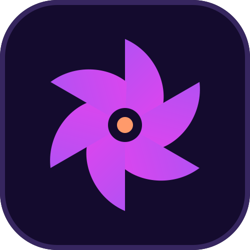
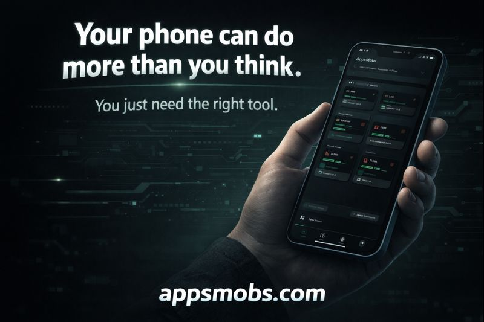
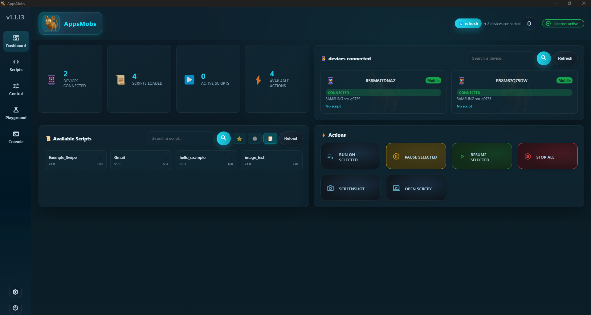
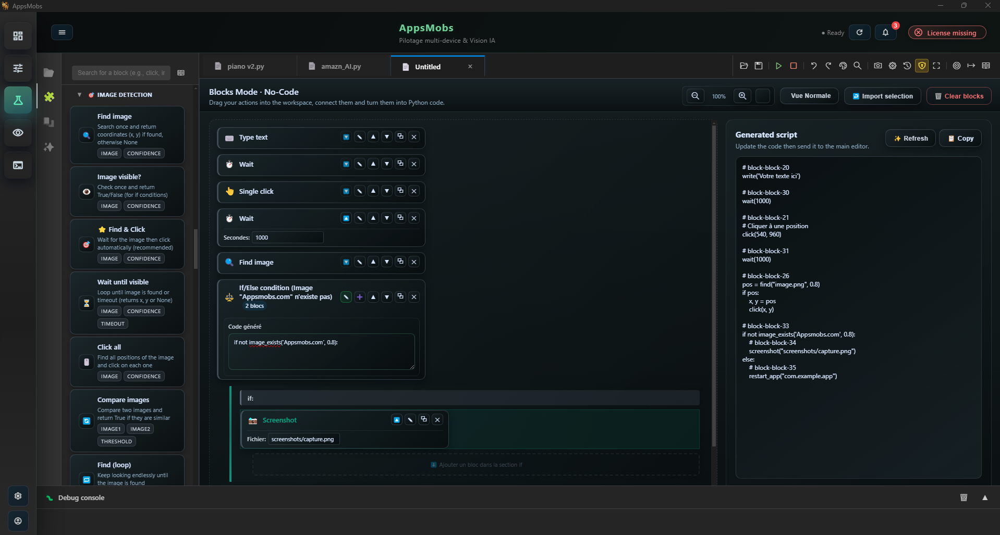
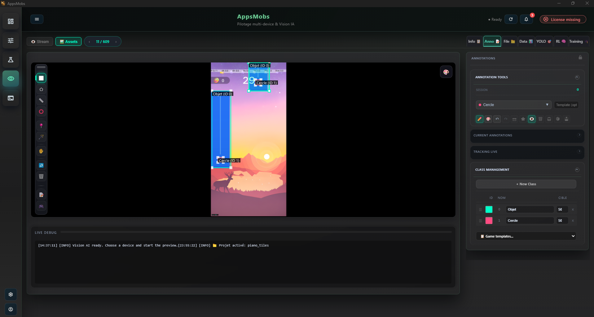
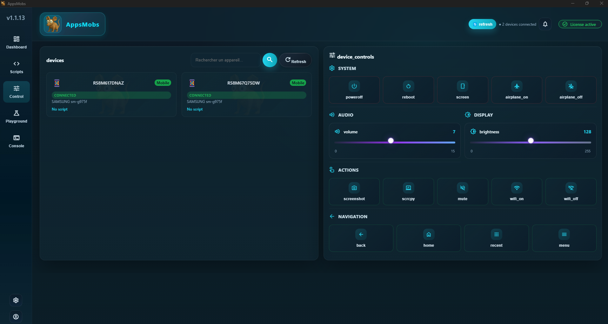
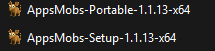
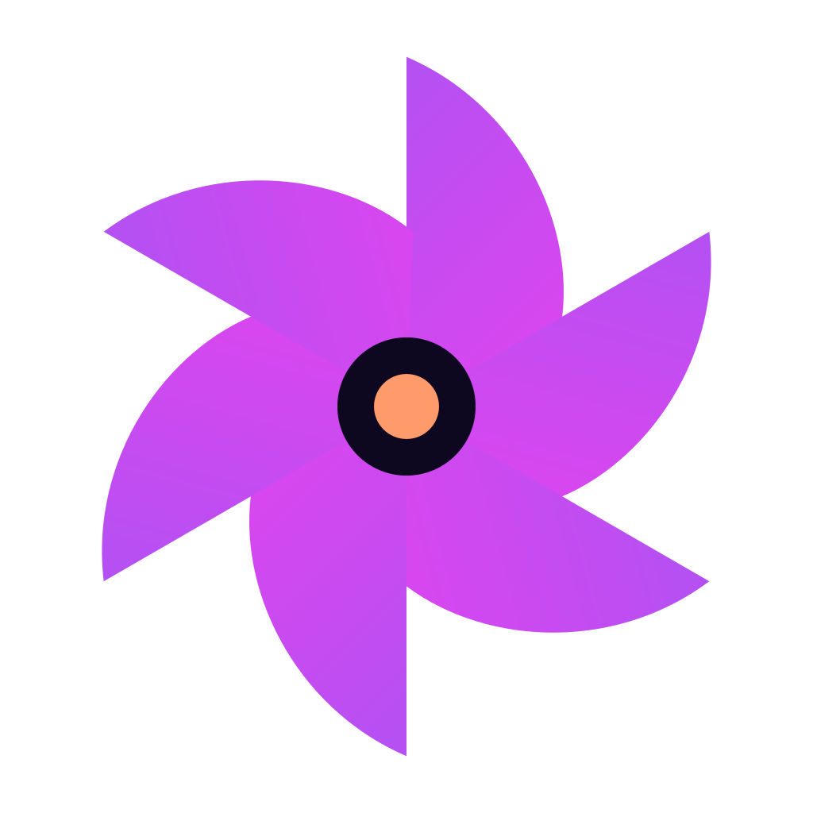
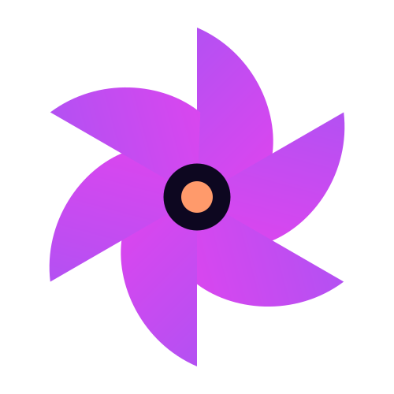

  

  <strong>🚀 Build once. Automate anything.</strong>

  <em>When APIs fail, vision works. Visual automation for real Android devices.</em>

  

  
  
  
  
  

---

## 📖 What is AppsMobs?

**AppsMobs** is a Windows desktop application that lets you **control and automate Android devices** from your PC. It brings everything into one tool: multi-device screen streaming (scrcpy), **Python scripts**, a **No-Code block editor**, an **AI pack** so Claude, Grok or ChatGPT can write your scripts, and **Vision AI (YOLO)** to detect on-screen elements and click them automatically.

> **In short:** Android automation (scripts + vision AI) — all running locally on your machine, with no mandatory cloud subscription to run your automations.

---

## ✨ Key Features

### 📱 Multi-Device Control

- Connect **1 to 10 Android devices** at once (depending on your plan).
- **Real-time screen streaming** (scrcpy) for each device.
- Manual actions: tap, swipe, type, navigate.
- Centralized dashboard to manage all devices from one window.

  

### 🐍 Python Scripts & 100+ Functions

- Full **Python script editor** with syntax highlighting and autocomplete.
- **100+ built-in functions** for automation: `tap`, `swipe`, `wait`, `screenshot`, `read_text`, `input_text`, image find & click, loops, conditions, and more.
- Run the same script on one or multiple devices.
- Save and reuse scripts across projects.

**Example functions:**

| Category       | Examples |
|----------------|----------|
| 👆 Touch       | `tap(x, y)`, `swipe(x1, y1, x2, y2)`, `long_press(x, y)` |
| ⏱️ Wait        | `wait(seconds)`, `wait_image("button.png")`, `wait_text("OK")` |
| 📸 Screen      | `screenshot()`, `ocr_screen(region)`, `image_visible("icon.png")` |
| 🎯 Find & tap  | `tap_image("button.png")` — waits for an image on screen and taps it; `find_image("reward.png")` gives its position |
| ⌨️ Input       | `type_text("hello")`, `press_back()`, `press_home()` |
| 🤖 Vision AI   | `smart_detect(["classe"], model="Projet")`, `smart_click(["classe"], model="Projet")`, `detect_screen(model="Screens")`, `wait_screen("menu", model="Screens")` |

  

### 🧩 No-Code Block Editor

- **Visual automation** without writing code: drag-and-drop blocks to build workflows.
- Blocks map to the same actions as the script API (tap, swipe, wait, conditions, loops).
- Ideal for beginners or quick one-off automations.
- Export block workflows to Python when you need to tweak or scale.

### 👁️ Vision AI (YOLO)

- **Train your own YOLO models** inside AppsMobs: annotate images, train, and run inference.
- **Real-time detection** on the device screen: detect buttons, rewards, UI elements, and click them automatically.
- When UI selectors or coordinates change, vision keeps working — no fragile XPath or pixel positions.
- Perfect for games, testing, and dynamic interfaces.

  

### 🎮 Device Control

- Control **one or multiple devices at once** from the app: power off, volume up/down, brightness, **Home**, **Back**, Recent apps.
- Direct actions per device: tap, swipe, type.
- Real-time screen view per device for monitoring and manual intervention.

  

### 🤖 Write Scripts with Your Own AI

- AppsMobs has no built-in assistant and never asks for an API key.
- Instead, the **AppsMobs AI pack** teaches the app and **every function** (exact signatures, script rules) to the AI you already use: **Claude, Grok, ChatGPT, Gemini**.
- Describe what you want in plain words (e.g. *"Tap the green button, wait 5 seconds, then swipe up"*), then paste the script into the Playground.
- Get the pack from the Playground (**Write it with Claude or Grok** card) or from the [AI pack guide](https://appsmobs.com/en/docs/ai-pack). A ready-made **Claude Skill** is also available.

### ⏰ Scheduled Tasks & Device Pool

- **Schedule scripts** to run at intervals (e.g. every 5 minutes) or at a fixed time.
- **Device pool**: assign devices to tasks; the scheduler runs the right script on the right device in order.
- Optional **state saving** to resume after a crash or restart.

---

## 💡 Why AppsMobs?

| Strength | Description |
|----------|-------------|
| **🔗 All-in-one** | ADB, scrcpy, Python, block editor, and Vision AI in a single Windows app — no need to wire multiple tools together. |
| **🏠 Local first** | Scripts and Vision AI run on your PC; execution does not depend on a cloud service. |
| **🔧 Flexible** | Use Python for power users, blocks for no-code, and your own AI (with the AppsMobs pack) to write either. |
| **👁️ Vision when it matters** | When APIs or UI trees fail, vision-based detection still finds and clicks the right elements. |
| **✨ No watermark** | Paid plans (including Player) ship without watermarks on your automations. |

---

## 🎯 Use Cases

| Use case | Description |
|----------|-------------|
| **📋 Repetitive tasks** | Automate the same taps, forms and checks you do every day on your phone. |
| **🎮 Mobile games** | Resource farming, repetitive loops, multi-account management. |
| **🧪 QA & testing** | Run the same scenario across several devices; schedule overnight runs. |
| **👥 Multi-account** | Control multiple devices or accounts from one PC with one dashboard. |

---

## 💳 Pricing

| Plan | Price/month | Devices | PCs | Scripts | Vision AI | Support |
|------|-------------|---------|-----|---------|-----------|---------|
| **Free** | €0 | 1 | 1 | Unlimited (1 h/day) | Provided models only | Community |
| **Player** | €9 | 3 | 1 | Unlimited | Yes, train your own models | Email 48h |
| **Pro** | €24 | 10 | 1 | Unlimited | Yes | Priority 48h |
| **Farm** | €49 | 30 | 3 | Unlimited | Yes | Priority 24h |

- Terms of **1 or 12 months**; 12 months = 2 months free (€90 / €240 / €490 per year), see [appsmobs.com](https://appsmobs.com/shop).
- **Enterprise** — Custom (30+ devices, on-premise, dedicated support).

*Prices are indicative; confirm on [appsmobs.com](https://appsmobs.com).*

---

## 📥 Installation & Setup

1. **Download** the latest release from [Releases](https://github.com/AppsMobs/AppsMobs/releases).
2. **Run** `AppsMobs-Setup-x64.exe` (installer) or `AppsMobs-Portable-x64.exe`.
3. **Connect** your Android device(s) via USB and enable **USB debugging**.
4. **Open** AppsMobs and follow the setup to connect your devices.

**Requirements:** Windows 10/11 (64-bit), Android device(s) with USB debugging enabled.

  

---

## 🔗 Links

| Link | URL |
|------|-----|
| **🌐 Website** | [appsmobs.com](https://appsmobs.com) |
| **📚 Documentation** | [appsmobs.com/docs](https://appsmobs.com/en/docs) |
| **📦 Releases** | [GitHub Releases](https://github.com/AppsMobs/AppsMobs/releases) |

---

  
  

  <strong>📄 License</strong> — See <a href="LICENSE">LICENSE</a>.

